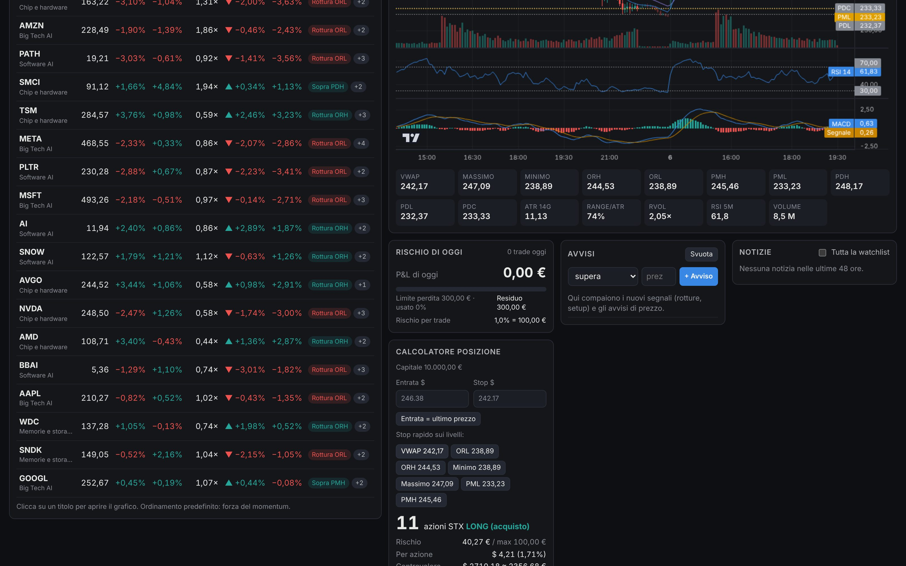

# AI Momentum Desk

Dashboard per il **day trading momentum/breakout** sui titoli legati all'intelligenza artificiale: chip, memorie, Big Tech e software AI.



*Nello screenshot: modalità demo, con dati simulati.*

## Cosa fa

| Area | Cosa trovi |
|---|---|
| **Scanner momentum** | Prezzo, variazione, gap d'apertura, **volume relativo (RVOL)**, distanza dal VWAP, forza relativa rispetto all'ETF dei semiconduttori (SMH) e segnali di rottura per ogni titolo della watchlist. Ordinato per forza del momentum. |
| **Grafico intraday** | Candele a 1, 5 e 15 minuti con VWAP, EMA 9/20, volumi, RSI e MACD. Le linee tratteggiate segnano i livelli chiave: range d'apertura (ORH/ORL), premarket (PMH/PML) e giorno precedente (PDH/PDL/PDC). |
| **Segnali e avvisi** | Rottura del range d'apertura, del massimo di ieri, del premarket e il *Setup long/short* completo (rottura + VWAP + volume + trend). Gli avvisi arrivano con suono e notifica, e puoi impostare avvisi su un prezzo. |
| **Notizie** | Notizie per titolo o per tutta la watchlist, con un sentiment indicativo (positivo, neutro o negativo) e le parole chiave che lo determinano. |
| **Rischio** | Calcolatore della posizione: rischi l'1% del conto (o la percentuale che scegli), inserisci entrata e stop, e la dashboard ti dice **quante azioni comprare**, con gli obiettivi a 1R, 2R e 3R. Il conto è in euro, i titoli in dollari: il cambio è gestito. |
| **Stop giornaliero** | Se la perdita del giorno raggiunge il limite (predefinito -3%), la dashboard te lo segnala in rosso. |
| **Diario trade** | Registri entrate e uscite e ottieni P&L in euro, multiplo di R, % di trade vincenti, profit factor e risultati per tipo di setup. Esportabile in CSV (si apre con Excel). |

Gli orari sono in **ora italiana**. La dashboard **non invia ordini**: gli ordini li inserisci tu su Directa.

---

## Avvio in 3 passi

### 1. Installa Python (solo la prima volta)
Scarica Python 3 da **https://www.python.org/downloads/** e installalo.
- **Windows:** durante l'installazione spunta **"Add python.exe to PATH"**.
- **Mac:** apri il file `.pkg` scaricato e segui l'installazione.

### 2. Scarica il progetto
Su GitHub premi **Code → Download ZIP**, estrai lo ZIP e apri la cartella `ai-trading-dashboard`.

### 3. Avvia la dashboard
- **Mac:** doppio clic su **`avvia.command`**. La prima volta macOS potrebbe bloccarlo: in quel caso fai clic destro, scegli **Apri** e conferma. Se non parte, apri il Terminale, trascina il file nella finestra e premi Invio.
- **Windows:** doppio clic su **`avvia.bat`**.
- **Linux:** `./avvia.sh`

Il primo avvio richiede circa un minuto, perché installa i componenti. Poi il browser si apre da solo su `http://127.0.0.1:8765`. **Lascia aperta la finestra nera** finché usi la dashboard: chiudendola, la dashboard si ferma.

All'inizio la dashboard è in **modalità demo**, con dati simulati, così puoi provare tutto subito.

---

## Collegare i dati reali (Alpaca, gratuito)

Alpaca offre gratuitamente prezzi in tempo reale, grafici e notizie sulle azioni USA.

1. Crea un account gratuito su **https://alpaca.markets**. Basta il conto **Paper Trading** (simulato): non devi depositare soldi.
2. Nel pannello di Alpaca cerca la sezione **API Keys** e genera una nuova chiave. Ottieni due codici: **API Key ID** e **Secret Key**. Copia subito la Secret, perché Alpaca la mostra una sola volta.
3. Nella dashboard vai in **Impostazioni → Fonte dati**:
   - Fonte: **Alpaca**
   - incolla **API Key ID** e **Secret Key**
   - Feed: **IEX (gratuito)**
   - premi **Salva e collega**. Se compare "Connesso ad Alpaca", hai finito.

> **Da sapere:** con il feed gratuito IEX i volumi arrivano da una sola borsa, quindi sono più bassi di quelli che vedi su Directa. Il **volume relativo resta affidabile**, perché confronta numeri della stessa fonte. Per i volumi completi serve il feed SIP, a pagamento.

Le chiavi restano **solo sul tuo computer**, nel file `config.env`. Non condividerlo e non caricarlo su GitHub (è già escluso).

**Alternativa senza registrazione:** in Impostazioni puoi scegliere **Yahoo Finance**. Non serve nessuna chiave, ma è un servizio non ufficiale: i dati possono essere in ritardo e a volte smette di funzionare.

---

## Come usarla in una giornata di trading

| Ora italiana | Cosa fare |
|---|---|
| **10:00 – 15:30** premarket | Guarda lo scanner: titoli con **gap** e **RVOL** alto, più le **notizie**. Sono i candidati del giorno. Imposta avvisi di prezzo sui livelli chiave. |
| **15:30 – 15:45** | Lascia formare il **range d'apertura** (15 minuti, modificabile). Non inseguire le prime candele. |
| **Dalle 15:45** | Aspetta il segnale **Setup long/short**, oppure la rottura di ORH/PDH/PMH con volume. Nel calcolatore usa i pulsanti dei livelli (VWAP, ORL…) come stop: la dashboard ti dice quante azioni comprare. Inserisci l'ordine su Directa. |
| **Dopo l'uscita** | Chiudi il trade nel **Diario**. Se compare il blocco dello **stop giornaliero**, per oggi hai finito. |
| **22:00** | Chiusura. Rileggi il diario: quali setup funzionano davvero per te? |

Quando gli orari legali di USA ed Europa non coincidono (alcune settimane in marzo e tra ottobre e novembre), il mercato apre alle 14:30 italiane. La dashboard lo gestisce in automatico.

La scheda **Guida** della dashboard spiega ogni colonna, livello e segnale.

---

## Impostazioni principali

Si cambiano dalla scheda **Impostazioni**, senza toccare codice:

- **Watchlist:** gruppi di titoli modificabili. All'inizio: chip (NVDA, AMD, AVGO, TSM, MRVL, ARM, MU, SMCI), memorie (SNDK, WDC, STX), Big Tech (MSFT, GOOGL, META, AMZN, AAPL) e software AI (PLTR, SNOW, AI, PATH, SOUN, BBAI).
- **Rischio:** capitale in €, rischio per trade (1%), perdita massima giornaliera (3%), posizione massima (25% del capitale), commissioni Directa per ordine, cambio EUR/USD (con aggiornamento dalla BCE).
- **Scanner:** durata del range d'apertura (5, 15 o 30 minuti), soglie di RVOL e di gap, frequenza di aggiornamento.
- **Avvisi:** quali segnali fanno suonare l'avviso, notifiche del browser.

---

## Privacy e sicurezza

- La dashboard gira **solo sul tuo computer**: è raggiungibile solo dall'indirizzo `127.0.0.1` e nessun altro dispositivo in rete può aprirla.
- Impostazioni e diario sono salvati in `data/`, le chiavi in `config.env`. Entrambi sono esclusi da Git.
- Le uniche connessioni esterne sono verso la fonte dati che scegli e, se premi "Aggiorna (BCE)", verso la Banca Centrale Europea per il cambio.

---

## Prossimi passi (app completa)

- Versione desktop installabile (icona sul Dock o nel menu Start, senza finestra nera).
- Integrazione con **Directa** tramite la piattaforma Darwin, da valutare sulla documentazione ufficiale delle API Directa.
- Grafico giornaliero e multi-giorno, heatmap del settore AI, calendario delle trimestrali.
- Statistiche del diario per fascia oraria e per titolo, con grafico dell'equity.

---

## Per sviluppatori

```
backend/            server Python (FastAPI)
  main.py           API: /api/scan, /api/chart, /api/news, /api/journal, /api/settings, ...
  scanner.py        livelli, RVOL e segnali momentum
  indicators.py     EMA, RSI, MACD, VWAP, ATR
  risk.py           dimensionamento della posizione, stop giornaliero, statistiche
  sentiment.py      sentiment delle notizie per parole chiave
  market.py         orari e festività NYSE, fusi orari
  providers/        alpaca.py, yahoo.py, demo.py (dati simulati)
frontend/           HTML/CSS/JS senza build; grafici con TradingView Lightweight Charts (Apache 2.0)
tests/              test automatici (pytest)
```

Per eseguire i test:

```
python3 -m venv .venv && source .venv/bin/activate
pip install -r requirements-dev.txt
python -m pytest -q
```

---

> **Avvertenza.** Questo è uno strumento di analisi, non un consiglio di investimento. I segnali sono regole tecniche automatiche e non garantiscono risultati. Il day trading è ad alto rischio e può comportare la perdita del capitale. Le decisioni di trading restano tue.
